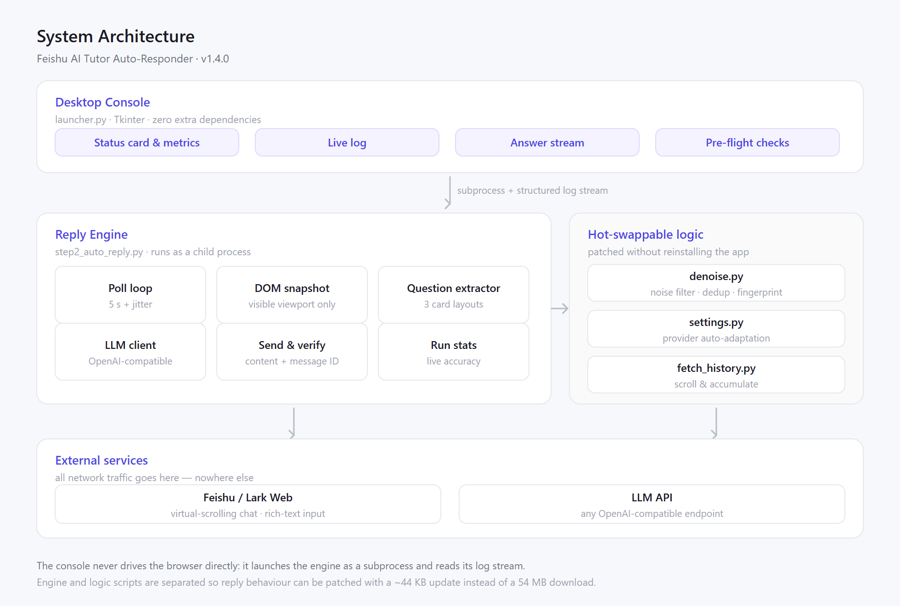
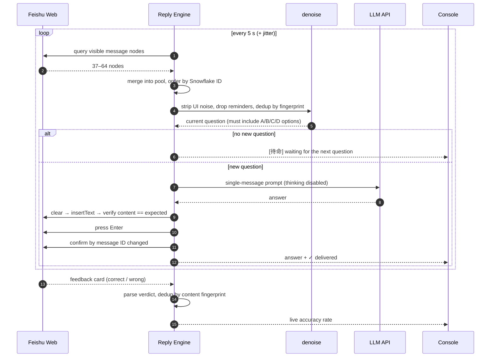
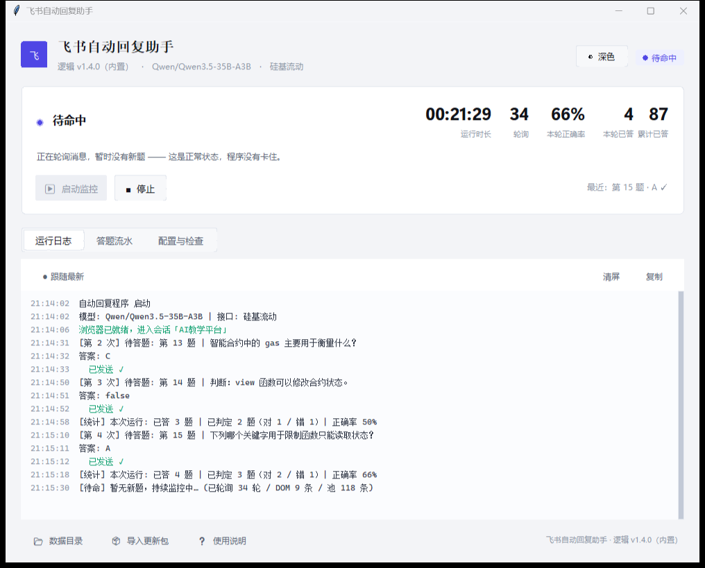
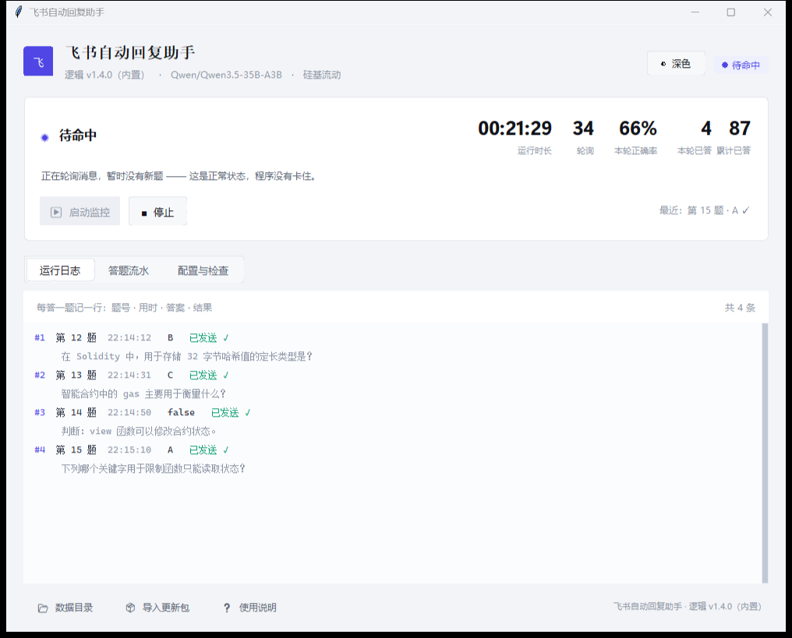
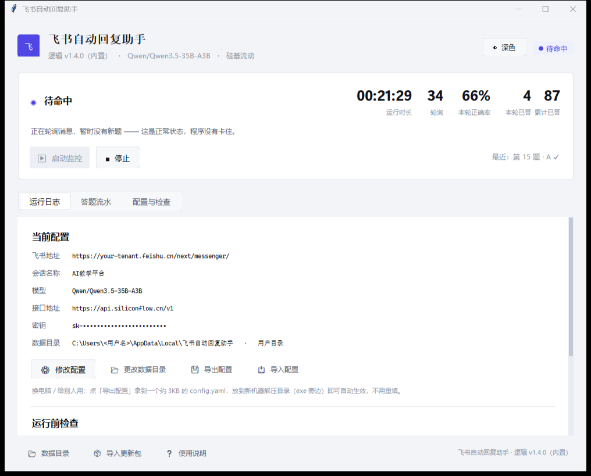
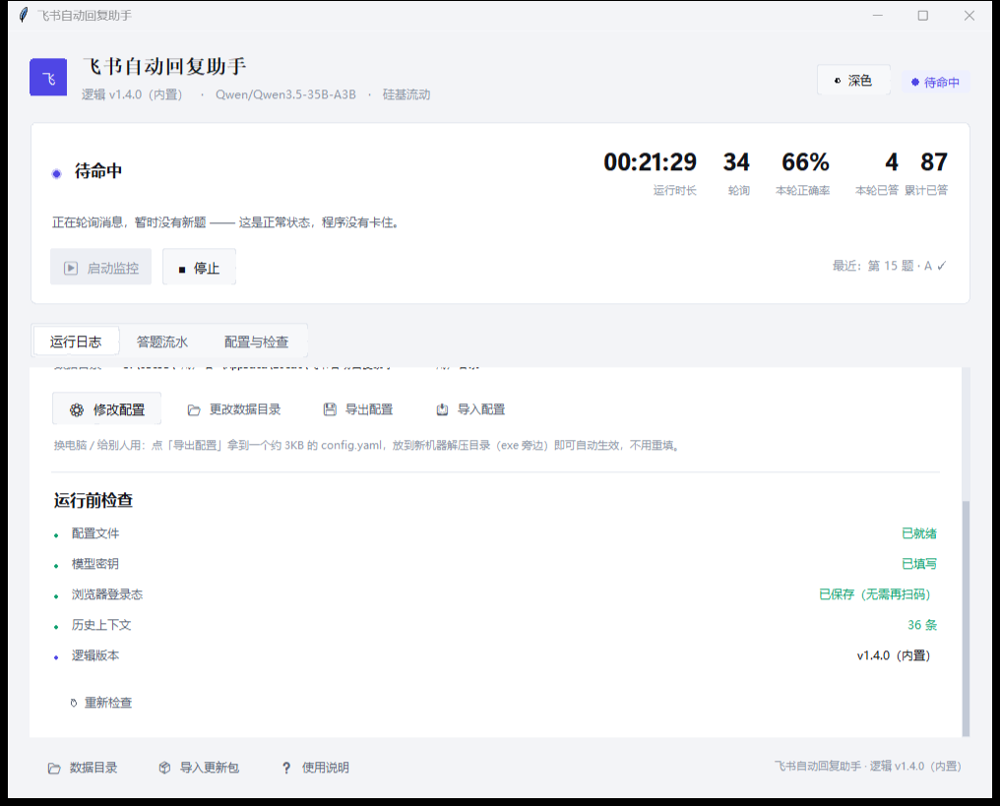

# Feishu AI Tutor Auto-Responder

**A Windows desktop assistant that watches a Feishu/Lark tutoring chatbot, answers each question with an LLM, and verifies that the answer was actually delivered — built for the messy reality of a virtual-scrolling chat UI.**

[](https://github.com/biziyvan/FRT-feishu-reply-tool-/releases/latest)
[](https://python.org)
[](https://playwright.dev)
[](LICENSE)

**English** · [简体中文](README.zh-CN.md)

---

## Table of Contents

- [Why this project exists](#why-this-project-exists)
- [What makes it non-trivial](#what-makes-it-non-trivial)
- [Features](#features)
- [Architecture](#architecture)
- [Request lifecycle](#request-lifecycle)
- [Screenshots](#screenshots)
- [Demo: one full answer cycle](#demo-one-full-answer-cycle)
- [Quick start](#quick-start)
- [Configuration](#configuration)
- [Engineering notes: three bugs that shaped the design](#engineering-notes-three-bugs-that-shaped-the-design)
- [Reliability & testing](#reliability--testing)
- [Tech stack](#tech-stack)
- [Data & privacy](#data--privacy)
- [License](#license)

---

## Why this project exists

Many online course platforms in China deliver quizzes through a Feishu (Lark) chatbot:
the bot pushes a question card, the learner replies with an answer, and the bot responds
with a feedback card containing the verdict and an explanation — then pushes the next question.

Answering this by hand is pure mechanical repetition. Automating it *looks* trivial
("just read the DOM and type a letter"), but the chat client turns out to be actively
hostile to automation:

- the message list uses **virtual scrolling** — only 37–64 nodes exist in the DOM at any time;
- the bot **re-pushes the same question** several times, sometimes 50% of all messages are duplicates;
- the same question can arrive in **three different card layouts**, one of which has no question number at all;
- the input box is **Lark's rich-text editor**, which keeps stale DOM nodes after sending;
- when the window is occluded or unfocused, Chromium **throttles timers and freezes rendering**.

This project is the result of taking those constraints seriously: a small, deliberately
engineered desktop tool rather than a fragile macro.

## What makes it non-trivial

| Constraint | Naive approach | Why it fails | What this project does |
|---|---|---|---|
| Virtual scrolling | Scrape all messages once | Only ~50 of 1000+ messages are in the DOM | Incremental accumulation keyed by message ID while scrolling |
| DOM order | Read top-to-bottom | DOM order ≠ chronological order | Restore real order from **Snowflake IDs** (embedded timestamps) |
| Duplicate pushes | Compare message prefixes | Same question number + same template ⇒ false match | Holistic containment only; explicit "same question" fingerprint |
| Rich-text input | Check if the box is empty | Stale nodes ⇒ thinks it failed ⇒ **sends twice** | Clear → insertText → **verify box content == intended answer** |
| Send confirmation | Count my messages +1 | Virtual scrolling ⇒ count may not change | Confirm by **message ID change**, not by count |
| Occluded window | `bringToFront()` every loop | Steals user focus every 5 seconds | CDP flags + `visibilityState` spoofing; **no focus stealing** |
| Cold start | Re-read everything | Slow, rate-limited | Read only the visible viewport; skip backlogged questions |

## Features

- **Automatic answering** — polls the chat, extracts the current question, calls an
  OpenAI-compatible LLM, sends the answer, and verifies delivery.
- **Correctness tracking** — parses the bot's feedback cards (`✅ correct` / `❌ wrong`) and
  shows a live per-run accuracy rate. Duplicate feedback is de-duplicated by content
  fingerprint; historical feedback present at startup is never counted.
- **Answer-type awareness** — multiple choice → a single letter; true/false → lowercase
  `true`/`false`; short answer → one or two sentences; code → minimal snippet with **no
  Markdown fences** (the platform grades fenced code as "material", not as an answer).
- **Provider auto-adaptation** — switching vendors means editing two lines
  (`base_url` + `model`). Thinking-mode parameters are derived automatically
  (SiliconFlow uses `enable_thinking`, DeepSeek uses `thinking: {type: disabled}`).
- **Engine / logic separation** — the UI shell is frozen into the `.exe`; the reply logic
  ships as ~44 KB hot-swappable scripts, so behaviour can be patched without a reinstall.
- **Portable configuration** — data lives in `%LOCALAPPDATA%`, decoupled from the unzip
  location; a pointer file relocates it, and `portable.txt` enables a fully portable mode.
- **Zero-dependency UI** — the entire interface is hand-drawn on Tkinter canvases
  (no Qt, no web view), with light/dark themes and DPI awareness.
- **Crash visibility** — atomic JSON writes with `.bak` fallback, send-failure circuit
  breaker, `sys.excepthook` **and** `threading.excepthook` persisted to disk (a windowed
  app has no console, so unhandled exceptions would otherwise vanish).

## Architecture



> Vector source: [`docs/architecture.svg`](docs/architecture.svg) — suitable for slides or application materials.

**Design intent.** The console never talks to the browser directly. It launches the reply
engine as a child process and reads a structured log stream — this keeps the UI responsive,
makes the engine runnable headless (CLI mode), and allows the engine to be replaced at
runtime without touching the frozen executable.

## Request lifecycle



## Screenshots

> Demonstration data only — tenant URL, API key and paths are redacted.

**Dashboard** — status card with per-run accuracy, poll counter and uptime:



**Answer stream** — one line per answered question, showing what was sent and whether it
was delivered:



**Configuration** — the console surfaces exactly where config and data live:



**Pre-flight checks** — config file, model key, browser session, history context and
logic version are verified before starting:



## Demo: one full answer cycle

1. **Start monitoring.** The engine launches Edge in headed mode, reusing the saved
   browser profile, and enters the target chat.
2. **The bot pushes a question.** The engine takes a viewport snapshot, orders messages by
   Snowflake ID, removes noise and duplicates, and extracts the question text *including
   its options*.
3. **The question goes to the model.** A single-message prompt (no multi-turn history, which
   previously caused the model to answer the *previous* question) with thinking mode
   explicitly disabled.
4. **The answer is typed and verified.** The input is cleared, the answer is inserted through
   CDP, and the box content is compared against the intended string. If they differ, the
   attempt is abandoned rather than risk sending a corrupted answer.
5. **Delivery is confirmed** by observing a change in message IDs — not by counting messages,
   which is unreliable under virtual scrolling.
6. **Feedback arrives.** The bot's verdict is parsed, de-duplicated, and folded into the
   per-run accuracy metric.

Terminal output for the same cycle:

```
[待命] 暂无新题，持续监控中… (已轮询 12 轮 / DOM 9 条 / 池 110 条)
[统计] 本次运行: 已答 12 题 | 已判定 9 题（对 7 / 错 2）| 正确率 77%
```

## Quick start

### Option A — portable build (recommended for end users)

1. Download `FRT-v1.4.0.zip` from [Releases](https://github.com/biziyvan/FRT-feishu-reply-tool-/releases/latest).
2. Unzip anywhere and run `飞书自动回复助手.exe`.
3. Fill in three fields: Feishu web URL, target chat name, LLM API key.
4. Click **启动监控** (Start monitoring), then scan the QR code once.

No Python installation required — the runtime and dependencies are bundled.

### Option B — run from source

```bash
python -m venv .venv
.venv\Scripts\python.exe -m pip install -r requirements.txt
copy config.example.yaml config.yaml    # then fill in your URL and API key
.venv\Scripts\python.exe launcher.py
```

Headless CLI mode:

```bash
.venv\Scripts\python.exe step2_auto_reply.py                  # run indefinitely
.venv\Scripts\python.exe step2_auto_reply.py --max-replies 10  # stop after 10 answers
.venv\Scripts\python.exe step2_auto_reply.py --dry-run -n 5    # dry run, do not send
```

## Configuration

`config.example.yaml` is the template. The most relevant keys:

| Key | Meaning |
|---|---|
| `feishu.base_url` | Feishu web URL (copy from the browser address bar) |
| `feishu.target_chat_name` | Name of the chatbot conversation |
| `browser.channel` | `msedge` (default) or `chrome` |
| `browser.headless` | **Must stay `false`** — Feishu's bot detection is strict |
| `browser.keep_front` | Periodically raise the window. Default `false` — deliberately does **not** steal focus |
| `polling.interval` / `jitter` | Poll interval (seconds) and random jitter |
| `context.max_chars` | Context character budget (token cost control) |
| `reply_strategy.latest_only` | Answer only the newest question; skip backlogged history |
| `llm.base_url` / `llm.model` | Any OpenAI-compatible endpoint |
| `llm.thinking` | `enabled` / `disabled`, or empty for auto-detection |
| `llm.system_prompt` | System prompt — the main lever on answer quality |

Switching providers only requires `base_url` and `model` to change.

### Using OpenAI

The LLM layer is vendor-neutral, and OpenAI is a first-class provider: the hostname
`api.openai.com` is recognised automatically, so no code change is involved.

```yaml
llm:
  base_url: "https://api.openai.com/v1"
  model: "gpt-4o-mini"        # or any chat model
  api_key: "sk-..."
  thinking: ""                # leave empty; auto-detection handles the rest
```

Why model quality matters more than it looks: the grading rubric is unforgiving on two
question types. True/false answers must be the exact lowercase literal `true` / `false` —
the Chinese equivalents are marked wrong. Code answers must be a bare snippet with **no
Markdown fences**, because fenced code is classified as "material" and silently not graded.
Smaller models violate both rules far more often, which is the main practical argument for
running this against a stronger model.

## Engineering notes: three bugs that shaped the design

These are documented because they explain most of the code's unusual decisions.

### 1. Answers were sent twice

The first implementation treated "input box is empty" as proof of a successful send and
counted "my messages + 1" as confirmation. Under virtual scrolling the message count can
stay constant even when a send succeeds, so a successful send was classified as a failure
and retried. A keyboard-simulation fallback made it worse: Lark's editor did not clear
completely, so a stale `B` plus a new `B` became `BC` — and **the platform only reads the
first letter**, so a correct answer was graded wrong.

**Fix:** verify the input content against the intended string *before* pressing Enter
(up to 3 re-clear attempts, then abort), and confirm delivery by **message ID change**.

### 2. The bot went permanently idle

Question de-duplication originally compared the first 16 characters of a fingerprint.
Different questions that shared a question number and a template opening line collapsed
into the same key, so every new question looked like "already answered" — the tool sat
idle indefinitely (observed: 7 minutes of silence).

**Fix:** only exact equality or mutual containment counts as a duplicate; when either side
has no question number, fall back to "the question stem is wholly contained" with a
minimum character overlap.

### 3. The distributed build crashed on launch

PyInstaller analyses only the entry module. Because the logic scripts are loaded at runtime
via `exec`, their imports never enter the dependency graph — so `logging.handlers` was
missing from the shipped executable and the app died with `ModuleNotFoundError` on first
run.

**Fix:** a three-layer guard — (a) `build.spec` walks the AST of every runtime script to
collect `hiddenimports`; (b) the packaging pipeline runs *the produced executable* and asks
it to import each module before declaring success; (c) the script itself falls back to a
built-in rotating handler so even older builds can be repaired by a logic update.

## Reliability & testing

All checks are headless except the UI suite, and every one of them is a regression test for
a specific past failure:

| Suite | Assertions | Guards against |
|---|---:|---|
| `test_send_guard.py` | 21 | Duplicate sends, corrupted input, wrong success criteria |
| `test_pending_question.py` | 39 | Question selection and de-duplication |
| `test_course_prompt.py` | 16 | Course-name auto-reply false triggers |
| `test_provider.py` | 62 | Vendor parameter mismatch (thinking silently left on) |
| `test_logic_update.py` | 39 | Update-package whitelist, path traversal, manifest cleanup |
| `test_robustness.py` | 78 | Atomic writes, circuit breaker, exit codes, log fallback |
| `test_data_dir.py` | 33 | Data-directory precedence and safe fallback |
| `test_cfg_layout.py` | 26 | UI clipping and theme regressions |
| **Total** | **314** | |

There is also a cross-module contract test: the console's log-parsing regex is used to parse
the engine's *actual* output, so if either side drifts the suite fails immediately.

## Tech stack

| Layer | Choice | Rationale |
|---|---|---|
| Browser automation | Playwright + CDP, Edge (headed) | Native input injection, no OS-level keyboard focus required |
| LLM | Any OpenAI-compatible API | Vendor-neutral; the default runs a small Qwen model |
| UI | Tkinter, hand-drawn canvases | Zero extra dependencies, ~1 MB of code instead of a bundled web view |
| Packaging | PyInstaller (one-folder) | 0.75 s cold start; a single-file build took ~110 s and was dropped |
| Update channel | Frozen shell + hot-swappable scripts | 44 KB patches instead of 54 MB downloads |

## Data & privacy

- No telemetry, no analytics, no network calls other than the chat page and the LLM endpoint
  you configure.
- `config.yaml` (which holds your API key) is git-ignored and never bundled into releases.
- Browser session data stays in the local data directory.
- This tool is intended for everyday Q&A assistance. It is explicitly **not** intended for
  exam cheating or any violation of academic integrity.

## License

[MIT](LICENSE).
