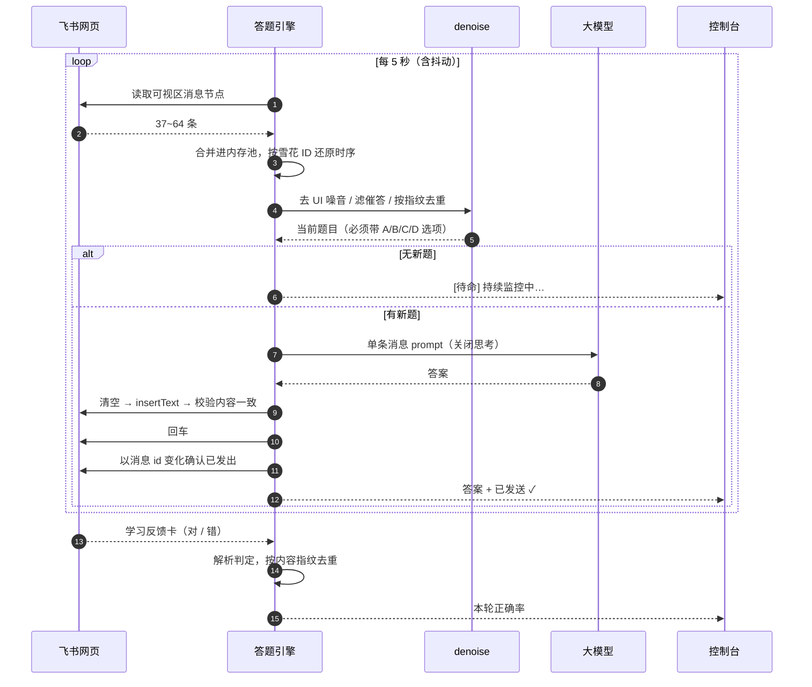

# 飞书 AI 教学平台 · 自动回复助手

自动监控「AI教学平台」机器人推送的题目 → 调用大模型生成答案 → 自动发送并**校验真的发出去了**。

[](https://github.com/biziyvan/FRT-feishu-reply-tool-/releases/latest)
[](https://python.org)
[](LICENSE)

[English](README.md) · **简体中文**

**技术路线**：Playwright + Edge 浏览器自动化（有头模式，复用登录态）
**外壳**：纯 Tkinter 桌面控制台（零额外依赖），打包为免安装绿色版

---

## 目录

- [一、这个工具解决什么问题](#一这个工具解决什么问题)
- [二、核心能力](#二核心能力)
- [三、架构](#三架构)
- [四、一次完整的答题流程](#四一次完整的答题流程)
- [五、界面截图](#五界面截图)
- [六、两种用法](#六两种用法)
- [七、环境说明](#七环境说明)
- [八、配置说明](#八配置说明configyaml)
- [九、核心机制](#九核心机制)
- [十、如何判断程序是否正常](#十如何判断程序是否正常)
- [十一、注意事项](#十一注意事项)
- [十二、开发与打包](#十二开发与打包)
- [十三、版本号与更新](#十三版本号与更新)
- [十四、许可与声明](#十四许可与声明)

---

## 一、这个工具解决什么问题

在线课程平台常用飞书机器人推题：机器人发一张题卡 → 学员回一句答案 → 机器人回「学习反馈」（对错 + 解析）→ 再推下一题。纯手工答，就是机械重复。

但把它自动化**并不等于「读 DOM 再打个字母」**，因为聊天客户端对自动化极不友好：

- 消息列表是**虚拟滚动**，DOM 里任意时刻只有 37~64 条
- 机器人会**重复推送同一题**（实测重复消息占比可达 50%）
- 同一道题有**三种卡片形态**，其中一种连题号都没有
- 输入框是 **Lark 富文本编辑器**，发送后会残留节点
- 窗口被遮挡 / 失焦时，Chromium 会**节流定时器、冻结渲染**

这个项目就是把这些坑一个个填平的结果——一个认真做过工程处理的桌面工具，而不是一个脆弱的宏。

## 二、核心能力

- **自动答题**：轮询会话 → 抽取当前题 → 调大模型 → 发送 → 校验送达
- **本轮正确率**：解析机器人回推的「学习反馈」卡（`✅ 答对了` / `❌ 答错了`），实时显示本次运行的准确率；重复推送按内容指纹去重，启动时界面上的历史反馈不计数
- **题型自适应**：选择题回单个字母；判断题回英文小写 `true`/`false`；简答一两句；代码题给极简片段且**不加 ``` 围栏**（平台会把带围栏的代码判成"资料"而不评分）
- **换厂商零改造**：只改 `base_url` + `model` 两行，思考模式参数自动适配（硅基流动用 `enable_thinking`，DeepSeek 用 `thinking: {type: disabled}`）
- **引擎 / 逻辑分离**：界面外壳固化进 exe，答题逻辑是 ~44 KB 可热替换脚本 —— 不重装也能修行为
- **配置可搬运**：数据存 `%LOCALAPPDATA%`，与解压位置无关；指针文件可改位置，`portable.txt` 可开纯便携模式
- **零依赖界面**：整个 UI 是手绘在 Tkinter Canvas 上的（不用 Qt、不嵌 WebView），带明暗主题与 DPI 适配
- **异常可见**：原子 JSON 写 + `.bak` 回退、发送失败熔断、`sys.excepthook` 与 `threading.excepthook` 全部落盘（窗口程序没有控制台，异常否则直接消失）

## 三、架构


> 矢量源文件：[`docs/architecture.svg`](docs/architecture.svg)，可直接用于申请材料或演示文稿。

**设计意图**：控制台从不直接操作浏览器。它把答题引擎拉成子进程、读结构化日志流——这样界面始终不卡、引擎能单独跑命令行模式，而且引擎可以在运行期被替换而不必碰已冻结的 exe。

## 四、一次完整的答题流程



## 五、界面截图

> 演示数据，租户地址、密钥与本地路径均已脱敏。

**运行日志** —— 状态卡显示本轮正确率、轮询次数与运行时长：


**答题流水** —— 每答一题一行，一眼看清答了什么、发没发出去：


**当前配置** —— 把配置与数据到底存在哪摊开给你看：


**运行前检查** —— 启动前校验配置 / 密钥 / 登录态 / 历史上下文 / 逻辑版本：


## 六、两种用法

### 方式一：绿色版（普通用户，推荐）

从 [Releases](https://github.com/biziyvan/FRT-feishu-reply-tool-/releases/latest) 下载 `FRT-v1.4.0.zip`：

1. 解压到任意文件夹（桌面、D 盘都行）
2. 双击里面的 `飞书自动回复助手.exe`
3. 首次运行填 3 项：飞书网页版地址、机器人会话名、大模型 API Key
4. 点「启动监控」，首次用手机飞书扫码登录一次

> 图文详解见随包的 `使用说明.txt`。
> **配置与解压位置无关**：数据存在用户目录，换解压位置、升级新版本都不会丢（见第十三节）。

### 方式二：源码运行（开发者）

```bash
# 1. 准备环境
python -m venv .venv
.venv\Scripts\python.exe -m pip install -r requirements.txt

# 2. 准备配置
copy config.example.yaml config.yaml    # 然后填入自己的地址与 API Key

# 3. 启动图形界面
.venv\Scripts\python.exe launcher.py

# 或者直接跑命令行版主程序
.venv\Scripts\python.exe step2_auto_reply.py --max-replies 10
```

`step2_auto_reply.py` 常用参数：

```bash
.venv\Scripts\python.exe step2_auto_reply.py                  # 一直运行（默认）
.venv\Scripts\python.exe step2_auto_reply.py --max-replies 10  # 答满 10 题后停止
.venv\Scripts\python.exe step2_auto_reply.py --dry-run -n 5    # 干跑，不真发
```

## 七、环境说明

| 项 | 说明 |
|---|---|
| Python | 3.8+（3.13 已验证） |
| 依赖 | `playwright` / `pyyaml` / `requests`（仅这三个） |
| 浏览器 | **Microsoft Edge**（`channel: msedge`，Win10/11 自带；也可改 `chrome`） |
| 登录态 | 登录一次长期复用，默认存在数据目录的 `.browser_data` |
| 界面 | Tkinter（Python 自带，无需安装） |

> 绿色版已把 Python、依赖、界面全部打包进 `_internal/`，用户无需任何环境。

## 八、配置说明（config.yaml）

配置示例见 `config.example.yaml`。常用项：

| 配置项 | 说明 |
|---|---|
| `feishu.base_url` | 飞书网页版地址（从浏览器地址栏复制） |
| `feishu.target_chat_name` | 目标会话名，默认「AI教学平台」 |
| `browser.channel` | `msedge`（Edge）/ `chrome`（Chrome） |
| `browser.headless` | **必须 false**，飞书对无头浏览器风控严格 |
| `browser.keep_front` | 是否周期性把浏览器窗口提到前台，默认 `false`（**不抢焦点**）。设为 `true` 可略降页面冻结概率，但会每隔几秒打断你正在做的事 |
| `polling.interval` / `jitter` | 轮询间隔（秒）与随机抖动，降低风控概率 |
| `context.context_size` | 上下文消息条数上限，默认 30 |
| `context.max_chars` | 上下文最大字符数，默认 3000（**控制 token 开支**） |
| `context.pool_max` | 内存消息池上限，默认 1200（长时间运行自动裁剪） |
| `reply_strategy.latest_only` | **只答最新一题**（默认 true），不补答历史旧题 |
| `reply_strategy.auto_reply_course` | 「请输入课程名」提示时自动回应的课程名；留空 `""` 则关闭 |
| `llm.provider` | 接口类型，默认 `"auto"`（按 `base_url` 自动识别，通常不用动） |
| `llm.base_url` | 接口地址（硅基流动 / DeepSeek / 任意 OpenAI 兼容网关） |
| `llm.model` | 模型名，默认 `Qwen/Qwen3.5-35B-A3B` |
| `llm.thinking` | 思考模式 `"enabled"` / `"disabled"`，留空则按接口自适应 |
| `llm.system_prompt` | 系统提示词（**准确率关键**） |
| `reply.send_delay_min/max` | 发送前随机延迟（秒），模拟真人 |

### 大模型接口自适应

**换厂商只需改 `base_url` 和 `model` 两行**，参数形式由程序自动判别：

| 接口 | 关闭思考的写法 | 备注 |
|---|---|---|
| 硅基流动 | `{"enable_thinking": false}` | 默认关思考 |
| DeepSeek | `{"thinking": {"type": "disabled"}}` | **官方默认开启思考**，程序会自动补上关闭参数；开启思考时 `temperature` 会静默失效 |

判定优先级：`base_url` 主机名 > 显式 `provider` > 模型名 > 通用。
填错了也不影响运行——以地址识别的结果为准，程序会在启动日志里提示改回 `"auto"`。

### 使用 OpenAI 官方接口

大模型层是厂商中立的，且 OpenAI 是一等公民：`api.openai.com` 这个主机名会被自动识别，
不需要改任何代码。

```yaml
llm:
  base_url: "https://api.openai.com/v1"
  model: "gpt-4o-mini"        # 或任意对话模型
  api_key: "sk-..."
  thinking: ""                # 留空，交给自动识别
```

为什么模型能力在这里比其他场景更关键：平台的判分规则对两类题型特别苛刻——

- **判断题**必须回英文小写 `true` / `false`，回中文「对 / 错」会被判错
- **代码题**必须是裸代码片段，**不能带代码围栏**——带围栏会被判成"资料"，直接不评分

模型越小，越容易犯这两类错误。这是本项目倾向使用更强模型的主要实际原因。

## 九、核心机制

### 1. 不反复滚动

飞书消息列表是**虚拟滚动**，DOM 里只保留几十条，且机器人会**重复推送同一题**。因此：

- **`fetch_history.py`**：偶尔手动跑，滚动抓全量历史（边滚边按消息 id 去重累积）
- **`step2_auto_reply.py`**：日常运行**只读当前可见消息**，不滚动 → 启动快、不卡死

### 2. 只答最新一题（`reply_strategy.latest_only`）

- 只在机器人推了**新题**、且是最新那道题时才回复
- 答完进入**待命状态**（日志显示 `[待命] 暂无新题，持续监控中…`），静默等新题
- 启动时历史里的积压旧题**一律跳过**，不会刷屏
- 想按时间倒序补答全部旧题，把 `latest_only` 改成 `false`

### 3. 正确识别"该答哪道题"（避免答非所问）

机器人有三种出题形态：

| 形态 | 特征 |
|---|---|
| ① `AI 自适应问答` 卡片 | 带题号，最规整 |
| ② `学习反馈` 卡片尾部夹带 | 带题号（"第 N 题"），前面是上一题的判定 |
| ③ 「请直接回复选项作答」+「当前题目：…」 | **常常不带题号** |

程序的做法：

1. 用**雪花 ID 高位时间戳**还原消息真实先后顺序（**不依赖 DOM 顺序**）
2. 从三种形态里抽出**当前要答的那道题**（题干必须带 A/B/C/D 选项，否则会答内容而非字母）
3. 判重**只允许"整体包含"**——精确相等或互为子串；任一方无题号时改用"题干整体包含"覆盖
   - ⚠️ **绝不能拿固定前 N 字符比较**：同题号 + 同模板句式的**不同题**会被误判成同题，导致永久待命不作答
4. 上下文里显式标注「★当前待答题目★」，防止模型串题

### 4. 去噪预处理（`denoise.py`）

处理三类噪音，大幅省 token：

- **UI 噪音**：无障碍提示、客户端下载提示等
- **催答提醒**：`学习提醒 / 你已经XX小时没有答题`（含误导性的课程名示例）
- **重复消息**：同一题重复推送 N 次（实测重复率高达 50%）

效果：**125 条 → 约 20 条，压缩率 ~85%**。
> ⚠️ 历史文件一律 `dedup=False` **全量保留**——去重方向与下游不一致会打断题目链。

### 5. 抗浏览器遮挡

浏览器被遮挡 / 最小化 / 失焦时，Chromium 会降级页面：定时器节流、渲染冻结、DOM 停更。
程序做了四层加固：

1. **抗节流启动参数**：关闭后台定时器节流、渲染降级、窗口遮挡检测
2. **伪装页面可见性**：让页面始终认为自己在可见状态（`visibilityState=visible`）
3. **不依赖键盘焦点发送**：用 CDP `Input.insertText` + `Input.dispatchKeyEvent` 直接走浏览器原生输入层
4. **失联自动恢复**：检测到页面失联时自动重载 / 新建页面并重进会话

> 实测：浏览器被遮挡时 `setInterval(100ms)` 3 秒内仍触发 **30/30 次**（默认会降到 0~1 次）。

### 6. 严格只发一次（防重复发送）

飞书输入框是 **Lark 富文本编辑器**，发送后输入框可能残留节点。历史上踩过两个坑：

- ❌ 用"输入框是否为空"判成功 → 误判 → 重复发送
- ❌ 用"我方消息条数 +1"判成功 → 虚拟滚动下**条数可能不变**，真发出却判失败 → 重发
- ❌ 键盘模拟兜底时清不干净 → 残留 + 新字母 = `BC`，而平台**只读第一个字母**，答对也判错

现在的做法：

1. **先"内容对齐"再发**：清空 → `insertText` → **校验输入框内容 == 要发的内容**
   （不一致就重清，最多 3 次；仍不一致就**放弃发送**，绝不发错）
2. **判是否发出看消息 id 变化**（不是条数）
3. 三条发送路径（CDP 原生输入 / 点击发送按钮 / 键盘模拟）每条执行前**先复查是否已发出**，一旦确认立即停止

### 7. 发送失败熔断

某题连续发送失败达到阈值后，会**复用首次生成的答案**再试，避免重试时输出漂移
（同一题两次生成不同答案，日志对不上、也无从判断哪次对）。

### 8. 作答口径

| 题型 | 输出 |
|---|---|
| 选择题 | 只回一个字母（`A`/`B`/`C`/`D`） |
| 判断题 | 只回英文 **小写** `true` / `false`（中文会被判错） |
| 简答题 | 一两句准确作答 |
| 代码题 | 极简代码 + 一句话说明；**禁止 ` ``` ` 围栏**（会被判成"资料"不评分）、不写注释、不做异常处理 |

## 十、如何判断程序是否正常

**界面版**：三个页签实时显示。

- 状态卡指标：**累计已答 / 本轮已答 / 本轮正确率 / 轮询 / 运行时长**
  - 「本轮正确率」= 本次启动监控后，机器人判定为**答对**的题数 ÷ **已判定**题数
  - 机器人是**判完卷才回推**「学习反馈」的，所以「已判定」会滞后于「已答」；
    收到第一条反馈前显示 `—`（不用 `0%` 冒充全错）
  - 同一条反馈被机器人重复推送时**只计一次**；启动瞬间界面上已有的历史反馈不算
- 「运行日志」完整运行记录（可「跟随最新 / 复制 / 清屏」）
- 「答题流水」每答一题一行，一眼看清答了什么、发没发出去
- 「配置与检查」当前配置明细 + 运行前自检（配置文件 / 模型密钥 / 浏览器登录态 / 历史上下文 / 逻辑版本）

**命令行版**：日志周期性打印

```
[待命] 暂无新题，持续监控中… (已轮询 12 轮 / DOM 9 条 / 池 110 条 / 最新: ...)
[统计] 本次运行: 已答 12 题 | 已判定 9 题（对 7 / 错 2）| 正确率 77%
```

看到这条说明一切正常，只是答完了在等新题（`latest_only: true` 的预期行为，**不是故障**）。

真故障才有：`循环出错` / `页面失联` / `恢复失败` / 进程消失。

日志文件：

| 文件 | 内容 |
|---|---|
| `live.log` | 实时日志，与界面显示一致（**绝不轮转**，界面靠增量读） |
| `auto_reply.log` | 历史日志，自动轮转（5MB × 5 份） |
| `launcher_error.log` | 界面层未捕获异常（正常时不存在；窗口程序没控制台，异常会直接消失） |

## 十一、注意事项

1. **必须有头模式**：无头会被飞书识别，导致掉登录或验证
2. **最好别关浏览器窗口**：被遮挡已能正常工作，但**直接关闭窗口**会失去登录页面（程序会尝试自动恢复）
3. **DOM 可能变化**：飞书前端升级后选择器若失效，用 `diag_dom.py` / `diag_page.py` 重新探测
4. **合规**：仅用于日常答疑场景，请勿用于考试作弊
5. **更新上下文**：换课程后跑一次 `fetch_history.py`，或删掉 `history.json` 重启
6. **清理残留进程**：异常中断后如遇浏览器被锁，`taskkill /F /IM msedge.exe` 再重启
7. **人机边界**：担心"答太快像机器"，可在 `reply.send_delay_min/max` 加大延迟
8. **`config.yaml` 含密钥**，不要上传或分享；推送仓库前先确认 `.gitignore` 生效

## 十二、开发与打包

### 打包

```bash
.venv\Scripts\python.exe package_release.py --build            # 绿色版 + 逻辑更新包 + 源码包
.venv\Scripts\python.exe package_release.py --set 1.5.0 --build # 同时升版本号
.venv\Scripts\python.exe package_release.py --with-config path\to\config.yaml  # 额外产「预置配置版」
.venv\Scripts\python.exe package_release.py --source-only      # 只产源码包
```

> ⚠️ `--with-config` 打出的包内含 API Key，注意分发范围。

**引擎 / 逻辑分离**是打包设计的核心：

- **引擎**：`launcher.py` / `runtime.py` —— 编进 exe（PYZ）
- **逻辑**：其余脚本 —— 作为数据文件打进 `_internal/`，运行期 `exec`

因此：**改逻辑脚本 → 逻辑更新包（几十 KB）即可；动到引擎或打包配置 → 必须重发完整绿色版**。

> ⚠️ 打包前请把旧 `dist/` **挪走**（同名目录无法覆盖），`package_release.py` 会自动挪到项目同级 `_feishu_build_trash/`，**只挪不删**。

### 测试

无头回归（快，可反复跑）：

```bash
.venv\Scripts\python.exe test_send_guard.py       # 发送链路防错（21 项）
.venv\Scripts\python.exe test_pending_question.py # 选题/判重（39 项）
.venv\Scripts\python.exe test_course_prompt.py    # 课程名自动回复（16 项）
.venv\Scripts\python.exe test_provider.py         # 大模型接口自适应（62 项）
.venv\Scripts\python.exe test_logic_update.py     # 逻辑更新包机制（39 项）
.venv\Scripts\python.exe test_robustness.py       # 稳健性（78 项）
.venv\Scripts\python.exe test_data_dir.py         # 数据目录优先级与回退（33 项）
```

合计 **314 项断言**，每一条都对应一个曾经真实发生过的故障。

图形界面自检（需带 tkinter 的解释器）：

```bash
set PYTHONPATH=
.buildenv313\Scripts\python.exe test_cfg_layout.py   # 配置页布局与配色（26 项）
```

> ⚠️ GUI 测试与无头套件**分开跑**——建过 Tk 窗口的进程收尾可能挂住，会拖住整条流水线。
> ⚠️ 若某些模块在打包后缺失，用锁定 `--run-sub` 与 `package_release.py` 的完整性卡口定位（见 `CHANGELOG.md` v1.1.0）。

### 诊断工具

| 脚本 | 用途 |
|---|---|
| `diag_messages.py` | 只读导出当前 DOM 全部消息原文（排查"答非所问"） |
| `diag_dom.py` | DOM 顺序 vs 雪花 ID 排序对比 |
| `diag_page.py` | 页面实况（URL / 可见性 / 消息 id 与方向） |
| `test_send.py` | 发送链路实测（含清空可靠性自检） |
| `test_background.py` / `test_occlusion.py` / `test_minimize.py` | 遮挡 / 失联恢复 / 最小化能力验证 |
| `test_choice.py` / `test_code_style.py` / `test_multiline.py` / `test_models_ab.py` | 提示词调优实验（只调大模型，不碰浏览器） |

## 十三、版本号与更新

### 命名规则

采用**语义化版本**，格式为 `主版本 . 次版本 . 补丁号`（如 `1.2.0`）：

| 位 | 何时 +1 | 举例 |
|---|---|---|
| **主版本** | 有不兼容改动（现有配置或数据需人工处理） | 1.2.0 → 2.0.0 |
| **次版本** | 向后兼容地**新增功能**，补丁位归零 | 1.1.1 → 1.2.0 |
| **补丁号** | 只**修问题**，不加功能、不改用法 | 1.2.0 → 1.2.1 |

补充约定：

- 当前处于 **1.x 阶段**，配置格式保持向后兼容，不轻易升主版本
- **已发布的版本号不修改**，发错了就发新版本
- 逐版改动明细见 [CHANGELOG.md](CHANGELOG.md)

### 两种升级方式

| 改了什么 | 怎么升 |
|---|---|
| 仅逻辑脚本（`step2_auto_reply.py` / `denoise.py` / `fetch_history.py` / `step1_check_login.py` / `settings.py`） | 下载**逻辑更新包**（几十 KB），在界面点「📦 更新包」导入 |
| 涉及**引擎**（`launcher.py` / `runtime.py`）或打包配置 | 必须换**完整绿色版**，逻辑包无法覆盖 |

> 判断依据：看 CHANGELOG 各版本末尾的「升级提示」。

### 数据与配置的位置

程序数据（配置 / 登录态 / 日志）存放在用户数据目录，**与解压位置无关**：

```
C:\Users\<用户名>\AppData\Local\飞书自动回复助手\
```

- 默认走用户目录，升级解压到任何文件夹都不会丢配置
- 想固定到某个位置（如 `C:\飞书自动回复助手`），用配置页的「更改数据目录」
- 换电脑或给别人用：用「导出配置」拿到 `config.yaml`，放到新机器**解压目录（exe 旁）**即自动接管，**不会覆盖对方已填好的配置**

## 十四、许可与声明

- 本工具仅供个人学习与日常答疑辅助使用
- 请勿用于考试作弊或任何违反学术诚信的场景
- 使用自动化工具的相关风险由使用者自行承担
- 本项目不收集任何遥测数据；除你配置的聊天页面与大模型接口外，不会发起任何网络请求

见 [LICENSE](LICENSE)。
